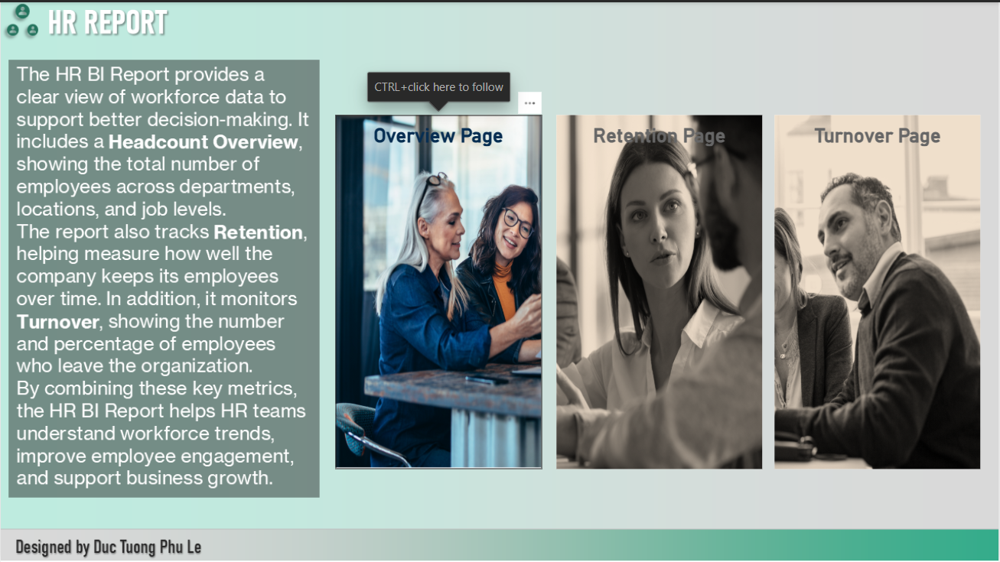
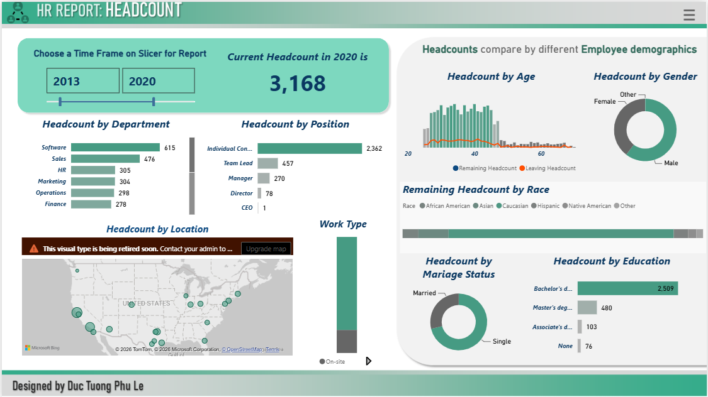
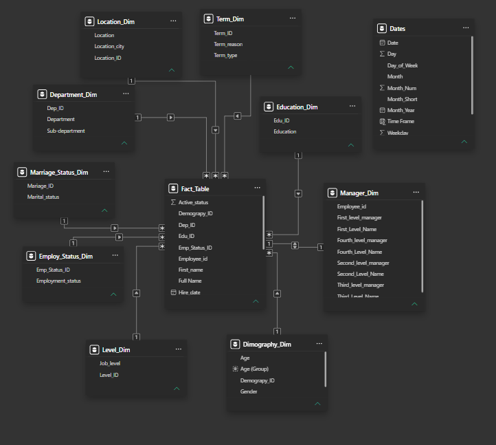
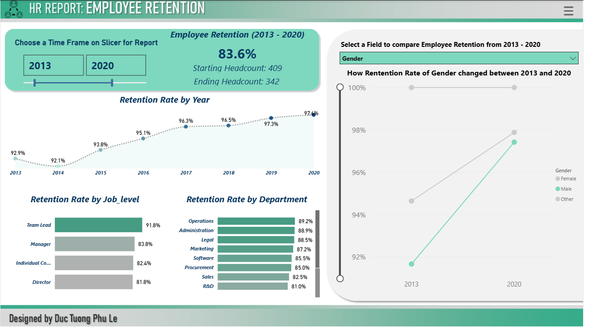
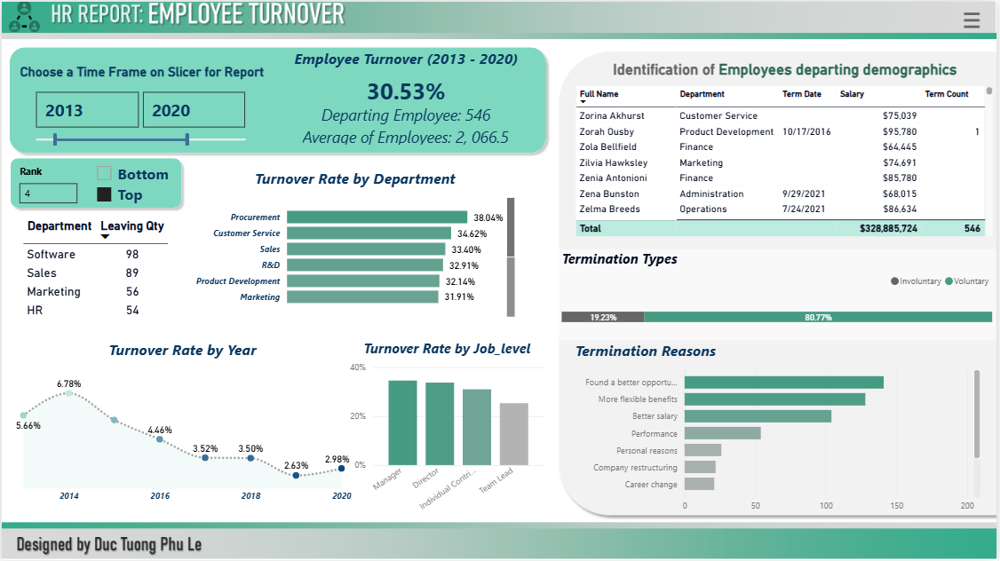

# HR Workforce, Retention & Turnover Analysis dashboard built in Power BI.

---

## 📌 Project Goal & Key Business Questions

The objective of this project is to transform raw employee lifecycle data into an interactive Business Intelligence solution that empowers HR leaders and department managers to make data-driven decisions across workforce planning, talent retention, and attrition reduction.

### Core Business Questions Addressed
1. **Workforce Overview & Distribution:** How is active headcount distributed across departments and job positions, and where are our core staffing resources concentrated?
2. **Overall Retention Performance:** What is our overall retention rate (`% Retention`), and how stable is our workforce across reporting periods?
3. **Retention by Department & Job Level:** Which departments and job levels demonstrate the strongest talent retention, and which segments show early signs of disengagement?
4. **Turnover & Attrition Velocity:** How do turnover rates and exit volumes fluctuate across departments, and which teams experience above-average attrition?
5. **Termination Root Causes:** What are the primary reasons behind employee terminations (e.g., voluntary vs. involuntary exits), and how much attrition is preventable?
6. **Strategic HR Interventions:** What actionable initiatives—such as targeted retention programs, leadership support, or compensation reviews—can be prioritized to reduce turnover in high-risk departments?

---

## 🎯 Project Outcomes
- Built a scalable Power BI HR reporting solution.
- Applied Star Schema data modeling principles for employee and organizational data.
- Developed reusable DAX measures for Headcount, Retention Rate (`%`), and Turnover Rate (`%`).
- Delivered executive-ready dashboards covering Overview, Retention, and Turnover diagnostics.
- Generated actionable insights to support proactive talent management decisions.

---

## Interactive Dashboard Features
- **Dynamic Cross-Filtering & Slicers:** Filter seamlessly across time periods (`Date Table`), departments, job levels, and job positions.
- **Page Navigation & Drill-Downs:** Switch between Workforce Overview, Retention Analysis, and Turnover Diagnostics views, or drill down from department level to specific job positions.
- **Custom Tooltips:** Hover over key KPIs and visuals to inspect secondary context (e.g., retention %, exit counts, and departmental benchmarks) without cluttering the main canvas.

---
## Data Modeling & ETL Pipeline (Power Query)

To ensure fast query execution, eliminate bi-directional filtering ambiguity, and support accurate time-intelligence calculations, raw HR and workforce tables were normalized into a strict **Star Schema**.
Data preparation was performed using **Power Query**.
---

### Transformation Steps
- Handled missing values (e.g., active employees without termination dates or incomplete department/job-level attributes)
- Corrected data types (dates, numeric headcount/tenure fields, and text keys)
- Standardized column names and category labels
- Cleaned employee, department, job position, and termination reason records
- Applied business rules for reporting (e.g., active vs. terminated status logic and standardized exit categories)
- **Table Normalization (Duplicate & Distinct Keys):** Duplicated raw employee/HR sheets in Power Query to isolate descriptive attributes from event/lifecycle records, applying column-specific deduplication (`Table.Distinct` on primary ID keys) to guarantee clean `1:*` cardinality.
- **Star Schema Architecture:** Built central fact/event tables connected via single-direction, one-to-many (`1:*`) relationships to dedicated Dimension tables (`Dim_Employee`, `Dim_Department`, `Dim_Position`, `Dim_Termination_Reason`).
- **Dedicated Date Table:** Created a continuous standalone **`Date Table`** marked as the official Date Table to power seamless period-over-period tracking across **Headcount**, **Retention (%)**, and **Turnover** metrics.

  

## Key DAX Measures & Analytical Pillars

### 1. Workforce Headcount & Demographic Analytics
- **Active Headcount Tracking:** Calculates `Current Headcount` dynamically across selected time slicers, separating remaining headcount from leaving headcount across age groups.
- **Organizational & Demographic Breakdown:** Segments workforce structure across **Departments**, **Job Positions**, **Location**, **Work Type**, and key demographic attributes such as **Gender**, **Race**, **Marital Status**, and **Education Level**.

#### Workforce Insights
- Headcount distribution highlights where core staffing and operational resources are concentrated across departments and job positions.
- Demographic and role breakdowns help identify workforce composition patterns and potential organizational imbalances.
---

### 2. Employee Retention & Cohort Stability Analytics
- **Period-over-Period Retention Rate:**
  - `Employee Retention %`: Measures workforce retention across selected reporting periods and annual trends to evaluate long-term stability.
  - `Retention Rate by Job Level & Department`: Compares retention across seniority tiers and business units to spot high-retention areas versus at-risk segments.
- **Dynamic Demographic Comparison:**
  - Enables interactive comparison across selectable fields (such as `Gender`) to observe how retention rates shift across chosen start and end periods.

#### Retention Performance
- Retention trends indicate how workforce stability evolves over time and across reporting periods.
- Comparing job levels and departments highlights which teams retain talent well and which groups face lower retention.
---

### 3. Employee Turnover & Attrition Diagnostics
- **Turnover Rate & Volume Metrics:** Tracks `Employee Turnover %`, departing employee counts, and average headcount across time periods and annual trends.
- **Dynamic Top-N / Bottom-N Ranking:** Uses dynamic ranking and slicers to highlight departments with the highest or lowest exit volumes and turnover rates.
- **Exit Classification & Root-Cause Breakdown:** Separates **Voluntary** vs. **Involuntary** exits and breaks down **Termination Reasons** alongside employee departure details.

#### Turnover & Attrition Insights
- Turnover metrics reveal both high-rate departments and high-volume exit areas requiring leadership attention.
- Analyzing voluntary versus involuntary exits and termination reasons helps pinpoint key drivers behind employee departures.

---

## Strategic Business Value: What Do These Numbers Improve?

Rather than merely reporting historical figures, each metric group is engineered to drive concrete workforce and operational improvements:

| Business Pillar | Key Metrics | How It Improves Business |
| :--- | :--- | :--- |
| **Workforce Overview** | Current Headcount, Remaining vs. Leaving Headcount, Demographics & Positions | **Smarter Resource Allocation:** Shows how headcount and roles are distributed across departments and locations to spot staffing gaps or over-concentration early. |
| **Employee Retention** | Employee Retention %, Retention by Department & Job Level, Field Comparison | **Targeted Talent Stability:** Pinpoints high-retention teams to replicate best practices and flags vulnerable departments or job levels before key talent leaves. |
| **Turnover & Attrition** | Employee Turnover %, Departing Employees, Top/Bottom-N Rank, Termination Reasons | **Proactive Retention Action:** Separates voluntary vs. involuntary exits and surfaces key termination reasons so HR can focus retention efforts where they matter most. |

---

## Key Challenges & Solutions

### 1. Scaling a Flat Dataset into a Star Schema
- **Challenge:** Raw HR records came in a flat structure, making multi-dimensional analysis slow and increasing the risk of ambiguous filter paths.
- **Solution:** Normalized the data into a **Star Schema** with central fact/event logic and clean single-direction (`1:*`) relationships to dimension tables.
- **Impact:** Faster report performance, cleaner DAX measures, and a scalable HR data model.

### 2. Accurate Headcount & Retention Across Timeframes
- **Challenge:** Simple counts or static snapshots can misrepresent workforce size and retention when users filter across different date ranges or reporting periods.
- **Solution:** Built time-aware DAX measures aligned with a standardized date structure to dynamically evaluate headcount and retention across selected periods.
- **Impact:** Reliable period-over-period tracking of workforce stability and retention trends.

### 3. Dynamic Demographic & Seniority Comparisons
- **Challenge:** Reviewing each demographic attribute or job level separately required repetitive visuals and cluttered the report canvas.
- **Solution:** Implemented dynamic field comparisons, job-level/department breakdowns, and rank controls (`Top` / `Bottom` filtering) within interactive visuals.
- **Impact:** Enabled leaders to quickly compare retention and turnover across departments, job levels, and demographic attributes in one place.

### 4. Diagnosing Turnover & Termination Drivers
- **Challenge:** Looking at total headcount alone hides whether exits are driven by voluntary moves, organizational changes, or specific department/role patterns.
- **Solution:** Structured turnover metrics alongside exit classifications (`Voluntary` vs. `Involuntary`), `Termination Reasons`, and `Leaving Qty` rankings.
- **Impact:** Helped identify high-attrition hotspots and root causes to guide more focused HR interventions.

---

## How to Explore This Project
- Download the `HR Final.pbix` report file in this repository and open it in **Microsoft Power BI Desktop** to inspect the Power Query transformations, Star Schema data model, and DAX measures.
- Repository: [HR Final.pbix](https://github.com/pforphu/HR-Analysis---Power-BI-/blob/main/HR%20Final.pbix)
